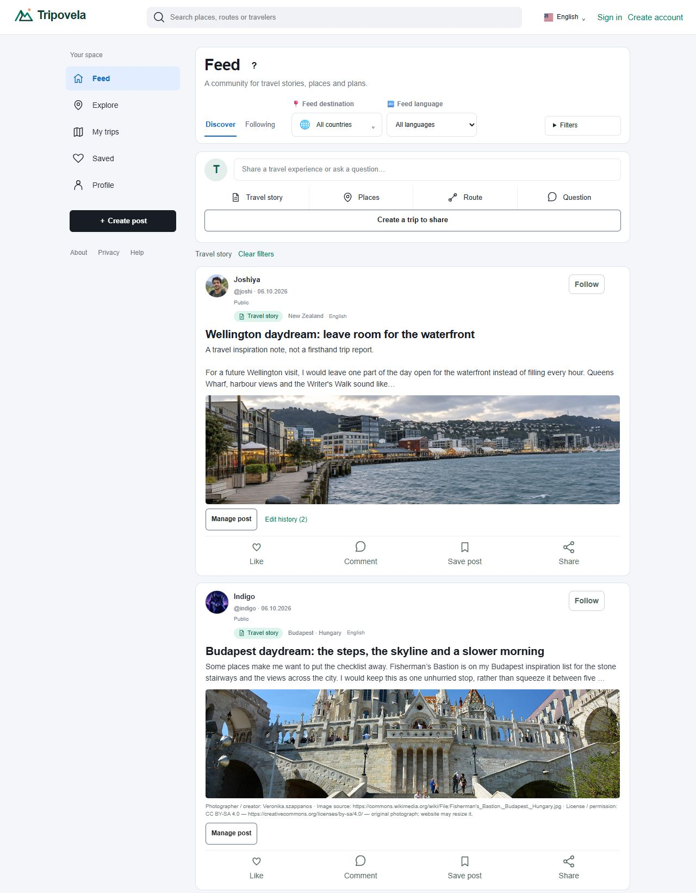
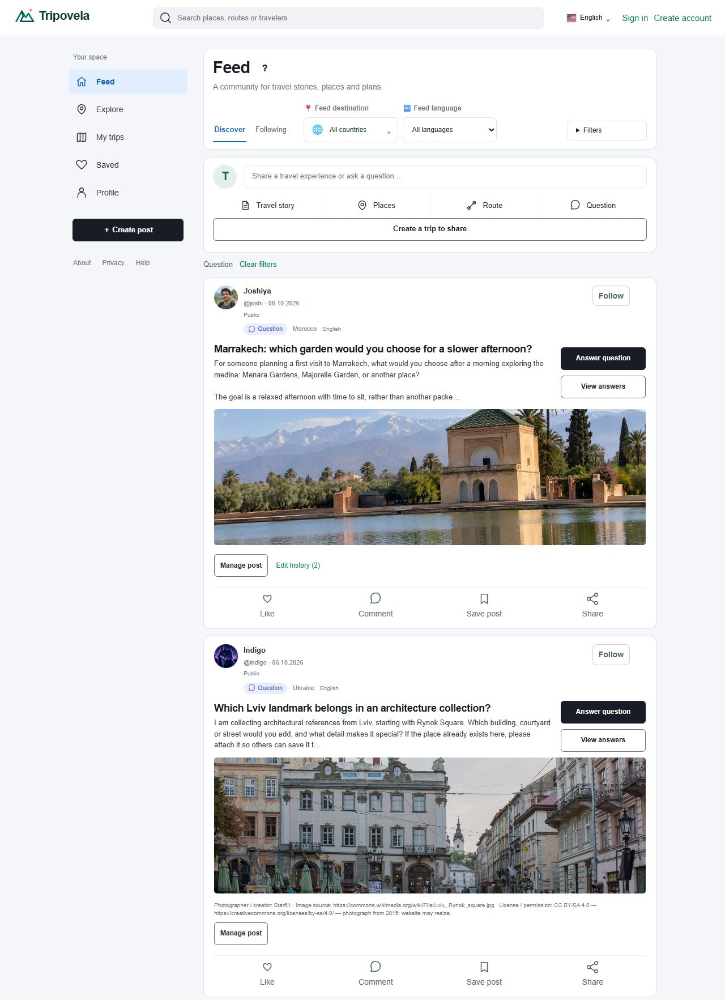
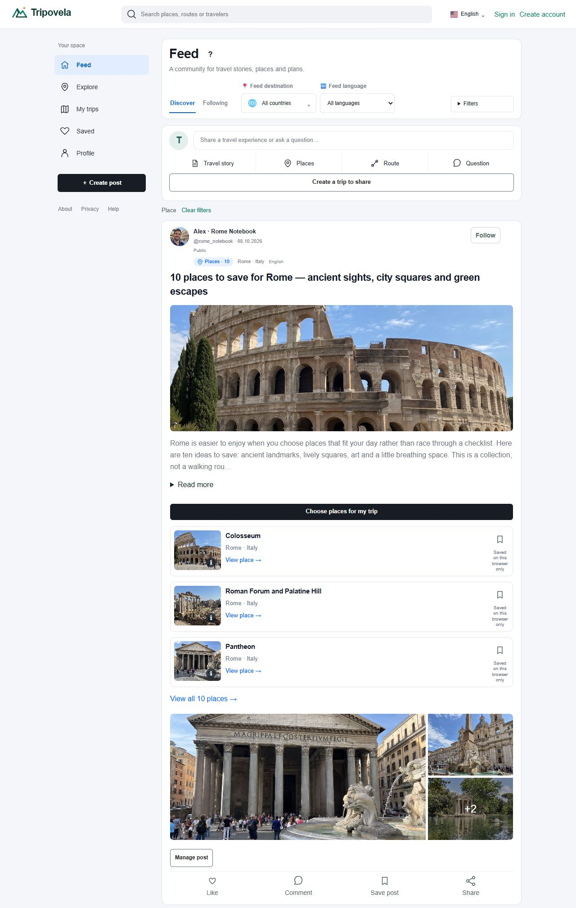
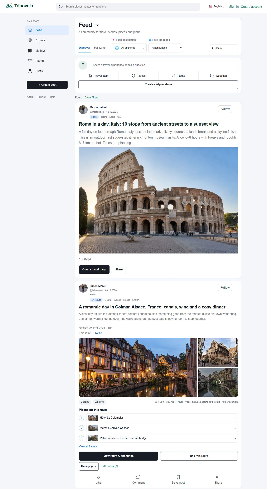
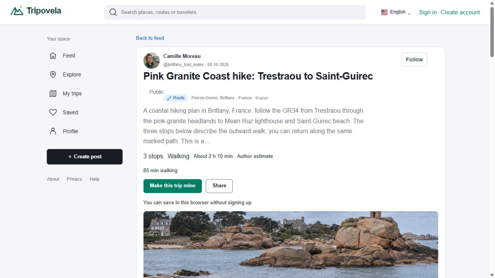
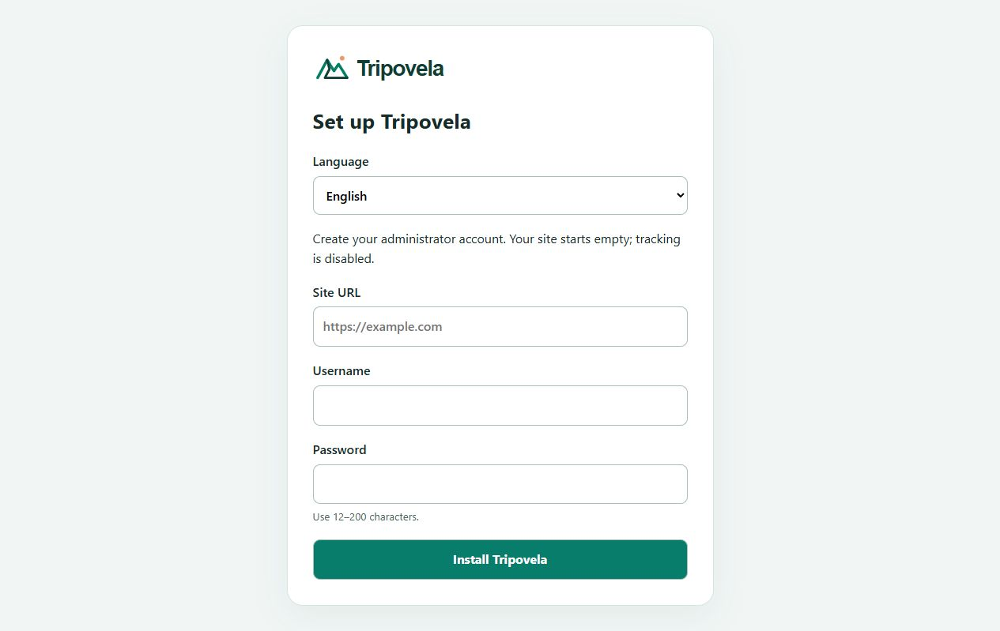

Every new or changed interface string must use a translation key with translations in all 14 supported languages. Preserve RTL/LTR behavior; user-authored content is not interface copy.

# Tripovela

**[Explore the live site → tripovela.com](https://tripovela.com)**

**A social network for travelers — think Pinterest for trip ideas, places and itineraries.**

**14 interface languages · Guest-friendly trip creation · Interactive maps · Personal copies · Shareable trips · MIT licensed, including commercial use**

Discover travel inspiration from other people, save what you love, make a trip your own and share it with others.

Tripovela combines a visual travel community, place discovery, personal trip editing and shareable trip pages. Start writing as a guest, add places to the story, keep a private copy and share a version when it is ready. Tripovela is an independent product and is not affiliated with Pinterest.

## A social feed built around travel

People publish **travel stories, place recommendations and collections, routes, and questions**. Each post keeps the author visible, with follow, like, comment, save and share actions. Browse the feed, join a conversation, or turn someone else's travel idea into your own trip.

The captures below show complete post cards from the live site, including public usernames and social actions. Click any image to see it at full resolution.

### Travel stories



### Questions and community answers



### Places and collections



### Routes and shared trips



## From an idea to a shared trip

- **Discover:** browse community posts and filter places and public trips by destination.
- **Create:** write freely, insert places and add personal stops. Long descriptions and timing details are optional.
- **Save:** guests keep drafts in their browser; members can save trips in their account. The interface distinguishes these storage states.
- **Make it yours:** copy an allowed trip into your own editable plan without changing its source.
- **Share:** share a snapshot and explicitly update the shared version later. Editing the private trip does not silently rewrite the shared snapshot.
- **Navigate:** explore numbered stops on OpenStreetMap, open an expanded map and choose a directions service. Dashed lines illustrate stop order; they are not calculated navigation routes.
- **Manage:** administer community content, translations, reports, short links, accounts and import/export tools.



See the [product gallery](docs/product-gallery.md) for the mixed feed, a full trip page from top to bottom, maps, the large photo gallery, administration and installation.

## Install

The application is PHP with SQLite and local translation files. Python helpers process images and content packages. No hosted translation service is required.

Requirements:

- PHP 8.0+ (PHP 8.3 recommended), with PDO SQLite, mbstring, DOM/XML, fileinfo, cURL and OpenSSL.
- Composer.
- Python 3.10+ and the packages in `requirements.txt`.
- Apache with rewrite support, Nginx with PHP-FPM, or PHP's built-in server for local development.

```sh
git clone https://github.com/MellowYAK/tripovela.git
cd tripovela
composer install --no-dev --prefer-dist
python3 -m venv .venv
.venv/bin/pip install -r requirements.txt
export TRIPOVELA_PYTHON="$PWD/.venv/bin/python"
php bin/install-token.php
php -S 127.0.0.1:8787 -t public public/router.php
```

Open `http://127.0.0.1:8787` followed by the private `/install/?token=…` path printed by the command. The setup page lets you choose the language, site URL, administrator username and password. The link expires after 30 minutes; an authorized setup session lasts at most 15 minutes.

The installer creates empty databases and a private `storage/site.env`, then sends you to `/KNISA/` to sign in. There is no default administrator password. Reinstallation is blocked when a database or configuration already exists. **Do not copy `.env.example` to `.env` before using the wizard.** It is a reference for manual configuration.



For production, use HTTPS and point the web server document root at **`public/` only**. Give the PHP worker write access to `storage/`, not to the source directory. Run the token command as the same operating-system user as PHP. Configure `TRIPOVELA_PYTHON` in PHP-FPM's environment. See [installation details](docs/installation.md).

## A clean distribution

This repository contains application code, interface dictionaries, schema definitions and documentation. It does **not** contain production databases, member accounts, passwords, session files, private trips, uploaded photos, server credentials or live analytics identifiers. The public-site screenshots are documentation assets, not seed data. Administration screenshots use a local installation and synthetic data, not Tripovela's real traffic or account statistics.

Analytics and advertising integrations are disabled by default. Affiliate credentials and destinations are unconfigured. Supply your own settings deliberately; no traffic is attributed to the original operator. Existing production databases must never be replaced with this installation's empty databases.

## Languages

**14 supported interface languages:** English, Hebrew, Russian, Georgian, Spanish, Italian, French, German, Arabic, Czech, Hungarian, Dutch, Polish and Portuguese.

English is the initial default. Manual language choices take precedence and right-to-left (RTL) layout is preserved for Hebrew and Arabic. Translations are stored locally; no external translation API is needed. User-written posts remain in their original language.

UI labels live in `content/*-labels.json` and `content/i18n/`. New administration strings use stable keys through `uiMessage()`. The older page-localization dictionary remains supported for existing screens.

## Verification and contribution

See [verification notes](docs/verification.md) for checks actually performed and their limits. A translation-key coverage check does not establish native-language editorial quality or validate every possible account state.

Keep runtime data and credentials outside commits. Use environment variables/private configuration for integrations. When changing an existing installation, deploy code separately from storage and back up databases consistently before schema changes.

The application code is available under the [MIT License](LICENSE), permitting personal and commercial use, modification and redistribution with the license notice retained. Third-party components retain their own licenses; OpenStreetMap attribution must remain visible. Documentation screenshots do not grant independent rights to the pictured travel content or user contributions. No blanket relicensing of third-party content is implied.
