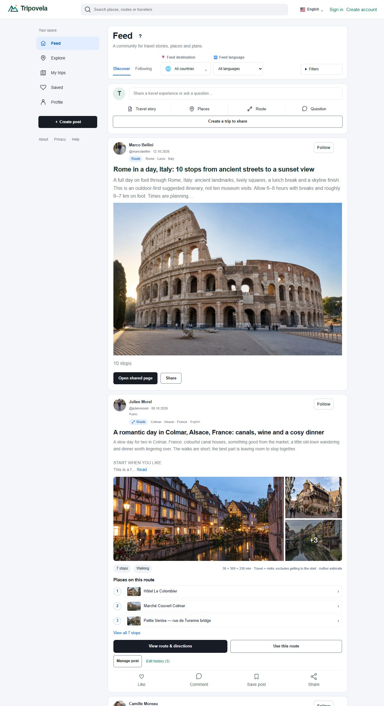
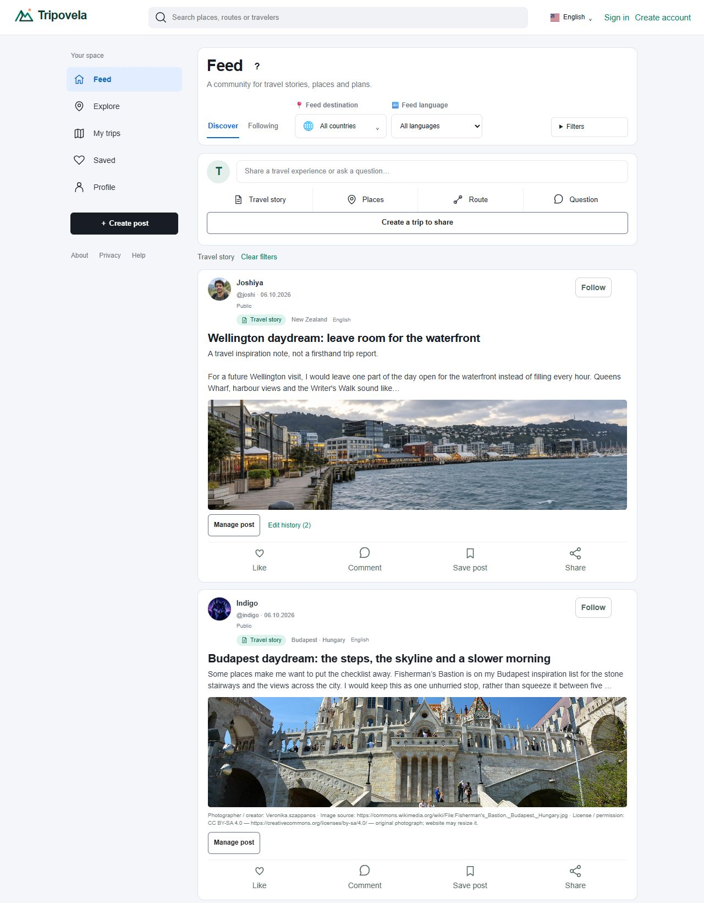
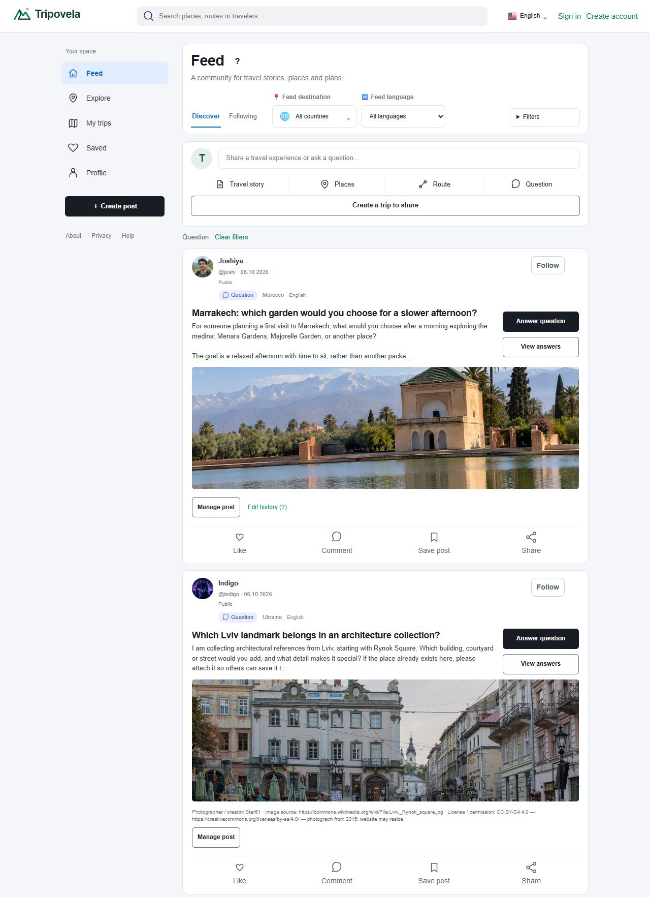
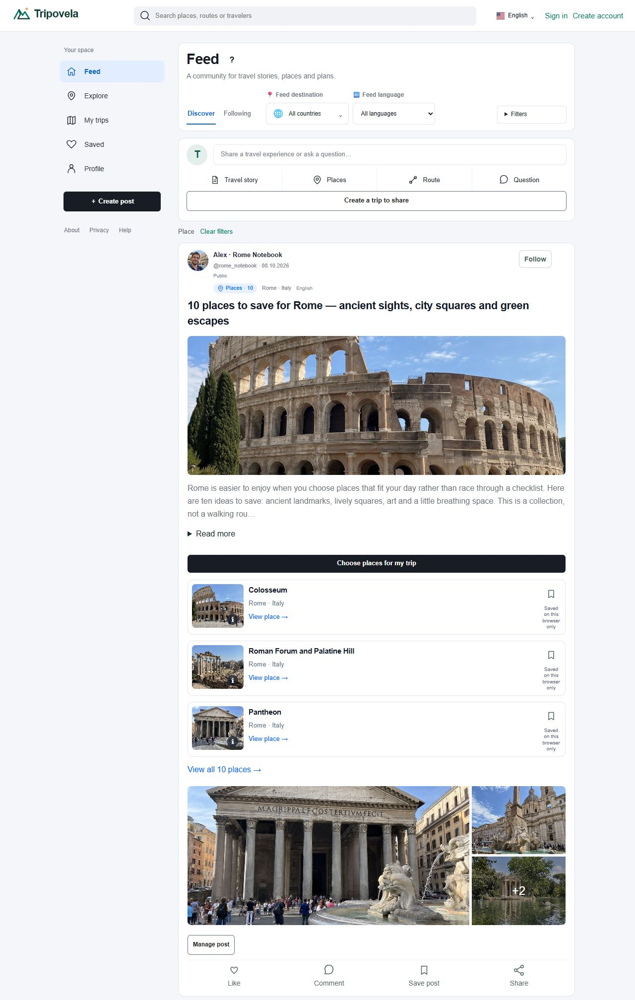
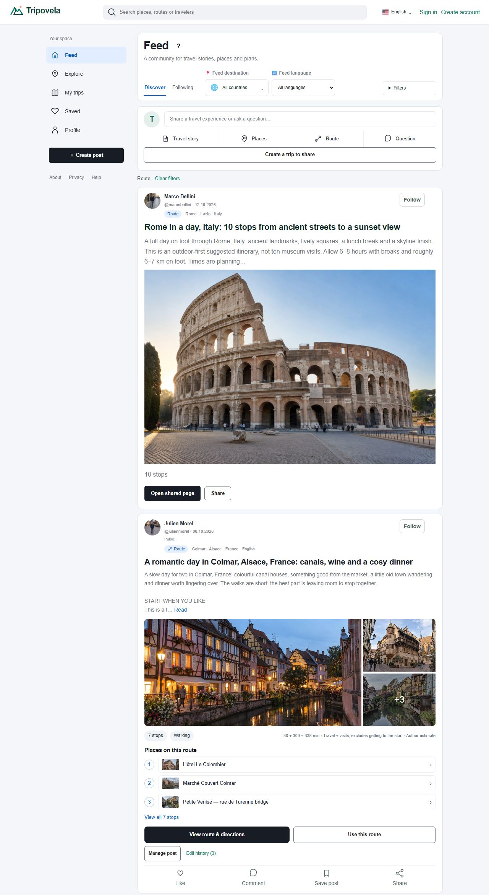
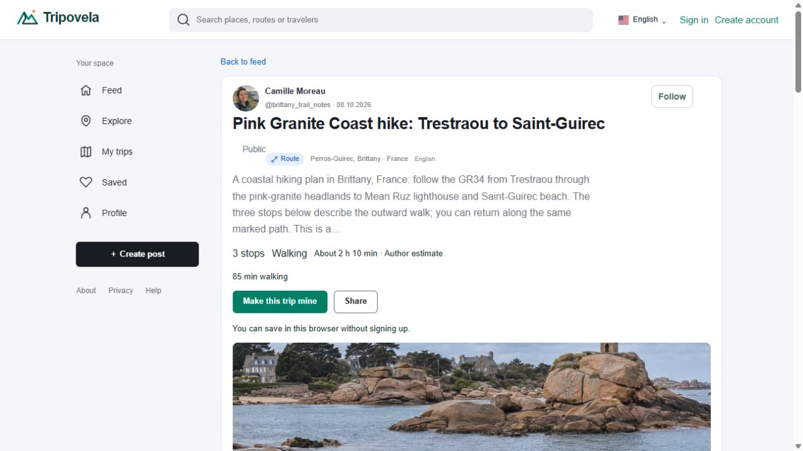
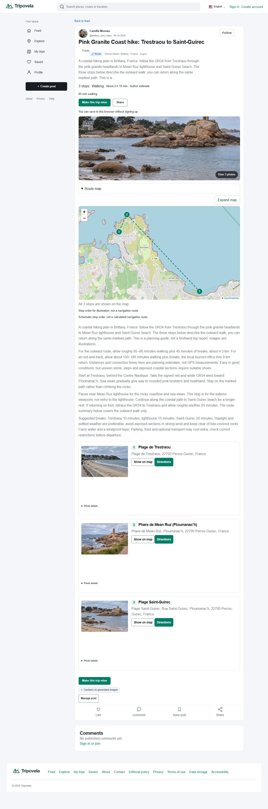
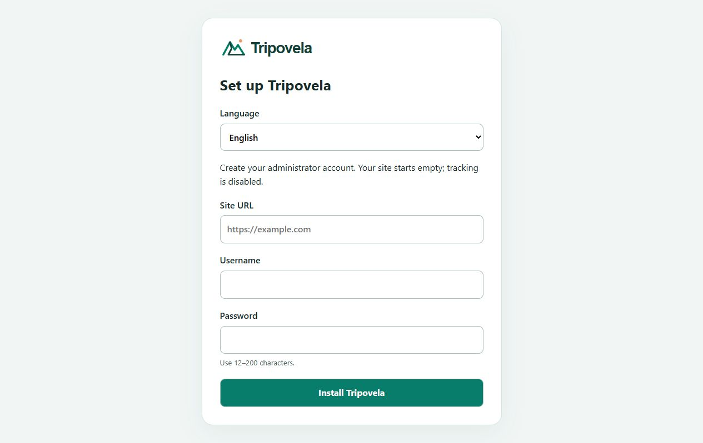

# Product gallery

These are browser captures of the working product. Live public trip pages were captured on 1 November 2026. The administrator testing toolbar is excluded from the product captures. Maps show schematic stop order, not routing-engine results.

## The social feed

The feed is the product's starting point: people, photographs, travel ideas and conversations. These captures retain public names and usernames. Only the administrator testing toolbar was temporarily excluded; no post text, counts or author identities were replaced. Feed captures include complete cards through their action rows, rather than only the top of a photograph.

## Travel stories

Photo-led posts share a travel experience or idea. Readers can follow the author, like, comment, save the post and share it.

## Questions

Question cards add prominent actions to answer or read the discussion, alongside the normal social actions.

## Places and collections

A collection contains real place cards with photos, individual save actions and an action to choose places for a personal trip.

## Routes

Route cards show their author, destination, photos and known trip details. Readers can open the trip, reuse it, or discuss and share it.

## Shared trips

An existing public trip shows its destination, summary, known estimates and immediate copying and sharing actions.

The following full-page capture includes the complete trip, its stops, social actions and comments area, from header to footer.

## Maps

An expanded OpenStreetMap view shows the ten Rome stops. Stop numbering follows the trip; the dashed line is explicitly schematic.

## Photography

The gallery uses a wide, stable viewing area with image containment and visible navigation.

## Administration and installation

Administration captures in this gallery come from an isolated local installation. Any populated statistics are synthetic sample data and do not represent real traffic, users, purchases or conversions. No private production reports are included.

