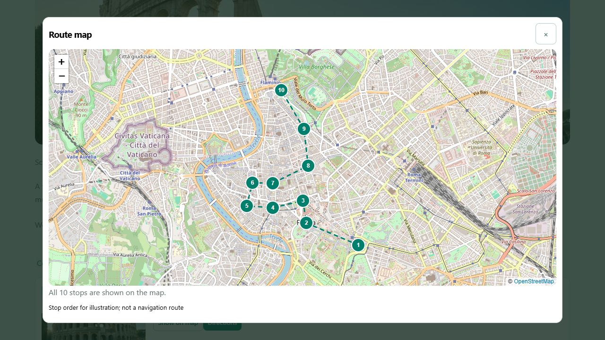
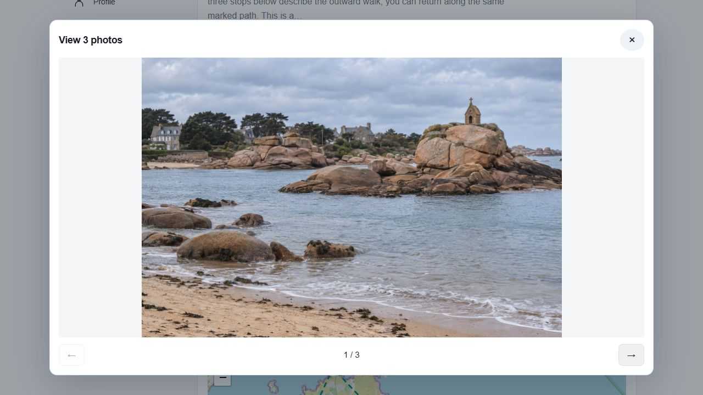
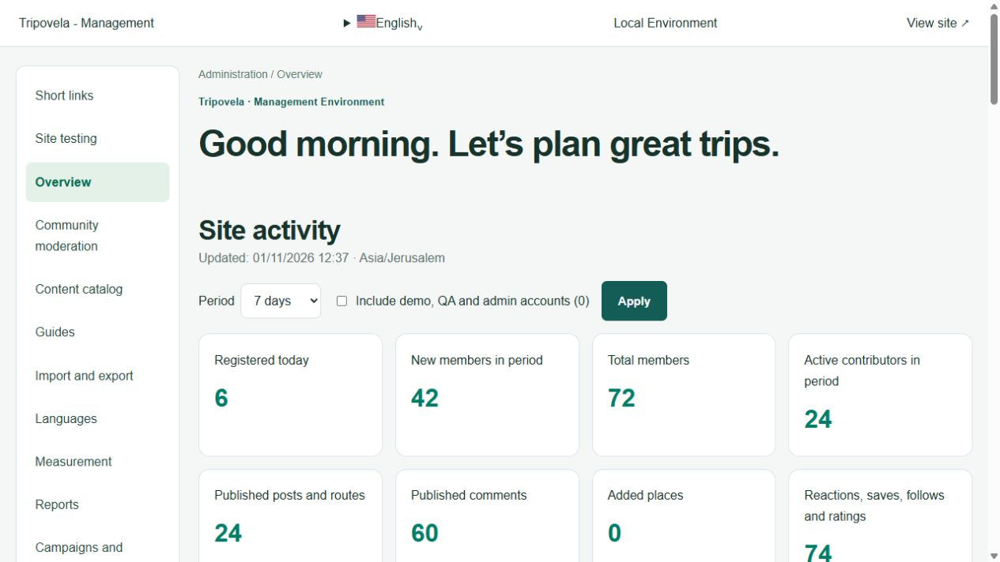
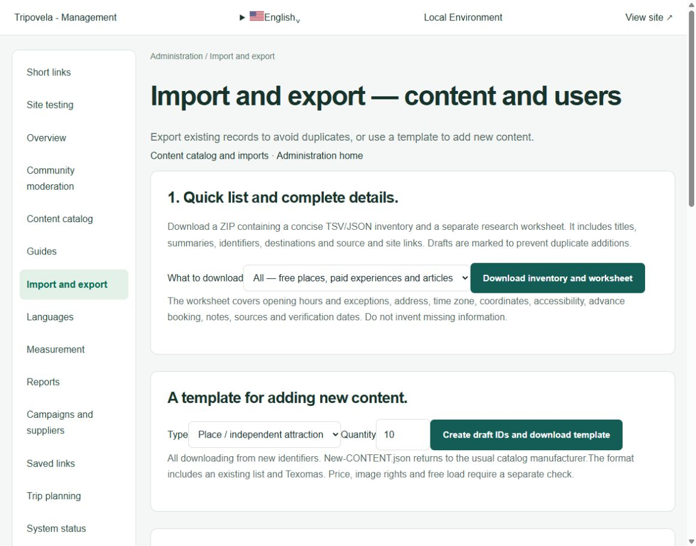

# Product gallery

These are browser captures of the working product. Live public trip pages were captured on 1 November 2026. The administrator testing toolbar is excluded from the product captures. Maps show schematic stop order, not routing-engine results.

## Shared trips

An existing public trip shows its destination, summary, known estimates and immediate copying and sharing actions.

## Maps

An expanded OpenStreetMap view shows the ten Rome stops. Stop numbering follows the trip; the dashed line is explicitly schematic.

## Photography

The gallery uses a wide, stable viewing area with image containment and visible navigation.

## Administration and installation

Administration captures in this gallery come from an isolated local installation. Any populated statistics are synthetic sample data and do not represent real traffic, users, purchases or conversions. No private production reports are included.

